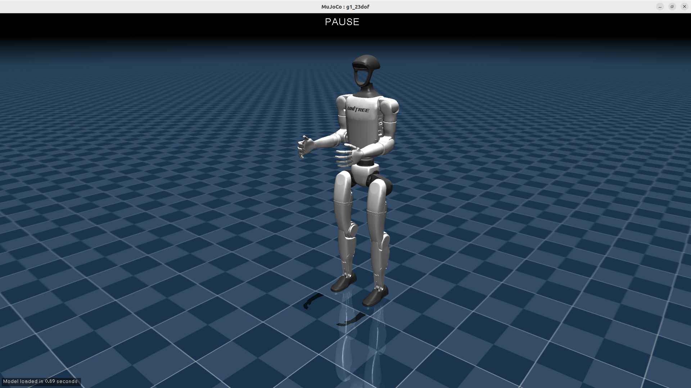
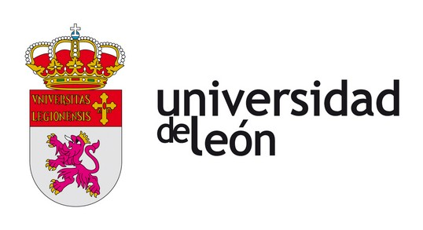

# g1_ws · Navigation and social navigation for the Unitree G1

<p align="center">
  
  
  
  
  
</p>

<p align="center">
  
</p>

*G1 model rendering from [Unitree Robotics](https://github.com/unitreerobotics/unitree_ros/blob/master/robots/g1_description/images/g1_23dof.png).*

This ROS 2 workspace connects Nav2 to the Unitree G1 EDU+ locomotion system. The navigation stack uses a LiDAR scan, odometry and a map to localize the robot and follow a goal. Social navigation adds person perception and coordinates stopping, communication and resumption when someone is in the robot’s path. OM integration is planned.

## System architecture


The overview shows the target architecture. Navigation configurations describe how the robot perceives and interacts during travel. High-level operational modes describe how it chooses and supervises actions. Shared OM coordination is part of the [integration roadmap](docs/oms.md). For the current execution paths, see [navigation](docs/navigation.md) and [social navigation](docs/social-navigation.md).

<details>
<summary><strong>Social navigation architecture</strong></summary>


[Read the social navigation guide](docs/social-navigation.md#social-navigation-architecture)

</details>

## Workspace at a glance

<details open>
<summary>Explore the project tree (selected paths)</summary>

```text
g1_ws/
├── src/
│   ├── rl_sar/src/rl_sar/       # Hardware, robot core and sensor launch files
│   ├── humanoid_nav_bridge/     # Real-robot and simulation bridge launch files
│   ├── g1_unitree_bridge/       # Includes the front video pipeline
│   ├── g1_nav2/                 # Navigation, localization, mapping and calibration
│   ├── g1_social_bringup/       # System launch and configuration
│   ├── g1_social_perception/    # Person identity and depth fusion
│   ├── g1_social_costmap/       # Social navigation costmap components
│   ├── g1_robot_collaboration/  # Navigation and interaction coordination
│   ├── g1_hri/                  # Human–robot interaction
│   ├── g1_robot_explainability/ # Robot explanations
│   └── g1_social_msgs/          # ROS 2 interfaces for the social stack
├── maps/                       # Map YAML files and occupancy images
├── scripts/                    # Trial recording and analysis
├── analysis/                   # Navigation results and figures
└── tools/                      # Environment and diagnostic utilities
```

</details>

## Start here

| I want to… | Open |
| --- | --- |
| Connect the PC and G1 over Ethernet | [Wired network setup](docs/network.md) |
| Prepare a Foxy or Humble terminal | [Host environment](docs/environment.md) |
| Launch locomotion from the robot or PC | [Unitree LOCO or custom policy](docs/locomotion.md) |
| Start hardware and select sensors and odometry | [Integrated or separate hardware bring-up](docs/hardware.md) |
| Choose where to launch components | [Robot, PC and hybrid deployment](docs/deployment.md) |
| Build a map with SLAM Toolbox or navigate on a saved map | [Mapping and autonomous navigation](docs/navigation.md) |
| Calibrate locomotion commands and odometry | [g1_navigation_calibration](https://github.com/JeanMayoko18/g1_navigation_calibration) |
| Run an encounter with a person and inspect the robot’s response | [Social navigation](docs/social-navigation.md) |
| Follow the planned OM integration | [OM roadmap](docs/oms.md) |

## Acknowledgements

This research is funded by the European Union through the Horizon Europe Marie Skłodowska-Curie Actions under the SWEET Industrial Doctoral Network (*Social aWareness for sErvicE roboTs*), grant agreement No. **101168792**. [SWEET project](https://www.sweet.unina.it/) · [EU grant record](https://cordis.europa.eu/project/id/101168792)

<p>
  <a href="https://www.unileon.es/"></a>
  &nbsp;&nbsp;
  <a href="https://www.sweet.unina.it/"></a>
  &nbsp;&nbsp;
  <a href="https://robotica.unileon.es/"></a>
</p>

The locomotion bridge was inspired by [fan-ziqi/rl_sar](https://github.com/fan-ziqi/rl_sar).

## Citation

If you use this workspace or any of its components in your research, please cite the software:

```bibtex
@software{mayokobiong2026g1ws,
  author = {Mayoko Biong, Jean Chrysostome and Sánchez-González, Lidia and Matellán-Olivera, Vicente},
  title  = {{g1\_ws}: Navigation and Social Navigation for the {Unitree G1}},
  url    = {https://github.com/JeanMayoko18/g1_social_navigation},
  year   = {2026}
}
```

**Affiliation**  
Robotics Group, I4 Institute  
Departamento de Ingenierías Mecánica, Informática y Aeroespacial  
Universidad de León, Spain

**Contact**  
jmayb@unileon.es · lidia.sanchez@unileon.es · vicente.matellan@unileon.es
