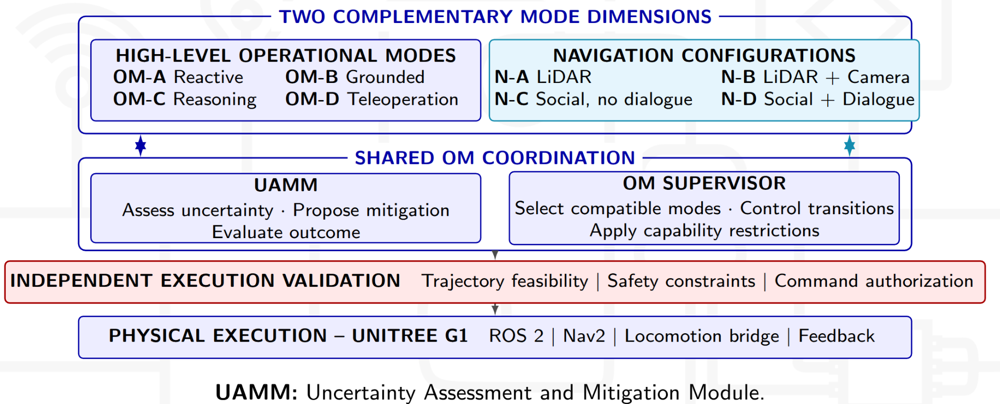
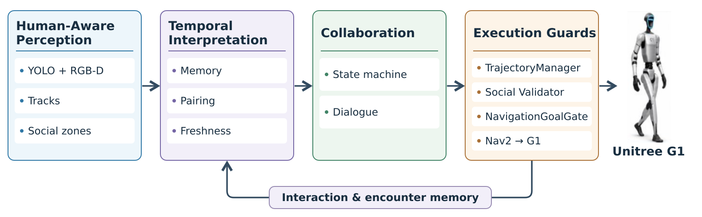
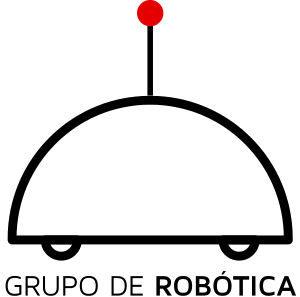

# g1_ws · Navigation and social navigation for the Unitree G1

<p align="center">
  
  
  
  
  
</p>

<p align="center">
  
</p>

*G1 model rendering from [Unitree Robotics](https://github.com/unitreerobotics/unitree_ros/blob/master/robots/g1_description/images/g1_23dof.png).*

This ROS 2 workspace connects Nav2 to the Unitree G1 EDU+ locomotion system. The navigation stack uses a LiDAR scan, odometry and a map to localize the robot and follow a goal. Social navigation adds person perception and coordinates stopping, communication and resumption when someone is in the robot’s path. OM integration is planned.

## Install and build before the first launch

Start with the [installation, PC-to-robot transfer and build guide](docs/installation.md).
It covers cloning the workspace, transferring sources from the PC to the G1,
installing dependencies, building the real-hardware locomotion bridge, and
building the navigation and social packages.

Build on each machine that will run project software. The project G1 uses
ROS 2 Foxy on ARM64. The development PC uses ROS 2 Humble on x86_64.
After the build, continue with the launch configuration for your deployment.

## Test the framework on your G1

Start with step 1, then open the task you want to run. Steps 3–5 accept an existing map of your environment. Each block identifies the host and includes a check for a successful run.

<details>
<summary><strong>1 · Shared hardware, scan and odometry</strong></summary>

Use a built workspace on each participating host. For a wired PC, complete the [Ethernet check](docs/network.md). In **each new terminal**, source the [host environment](docs/environment.md). On the PC use Humble; on the robot use Foxy. The examples below place hardware on the G1 and navigation on the PC.

**Terminal 1 · Start locomotion on the robot or PC**

Choose one of the four combinations below. The locomotion host can be
selected independently of the host running Nav2, perception or dialogue.
Start one locomotion executable for the session.

Prepare the [environment for the selected host](docs/environment.md).
The project G1 uses `eth0` on the robot. For a PC launch, first complete
the [Ethernet setup](docs/network.md). In the same PC terminal, identify
the wired interface connected to the G1 and enter its name:

```bash
ip -br addr
read -rp "Ethernet interface connected to the G1: " G1_IFACE
ip -br addr show dev "$G1_IFACE"
```

**Before launching a custom policy from either host**, press **L2 + R2
simultaneously** on the G1 controller and wait for Debug mode. If there
is no audible confirmation, check the robot’s Debug-mode indicator before
running the command.

| Launch host | Locomotion backend | Run this command |
| --- | --- | --- |
| Robot · ROS 2 Foxy | Unitree LOCO (default) | `ros2 run rl_sar rl_real_g1_edu23_unitree_loco eth0 --real --control-backend=unitree_loco --max-motion-duration=0.0` |
| Robot · ROS 2 Foxy | Custom policy | `ros2 run rl_sar rl_real_g1_edu23_unitree eth0 --real` |
| PC · ROS 2 Humble | Unitree LOCO (default) | `ros2 run rl_sar rl_real_g1_edu23_unitree_loco "$G1_IFACE" --real --control-backend=unitree_loco --max-motion-duration=0.0` |
| PC · ROS 2 Humble | Custom policy | `ros2 run rl_sar rl_real_g1_edu23_unitree "$G1_IFACE" --real` |

**For all four combinations**, use the terminal where you started locomotion:

1. Press **0** for **Bring Up**.
2. Wait until bring-up completes and the G1 reaches its ready posture.
3. Press **1** for **Enter Locomotion**.
4. Keep this terminal running and continue with shared hardware bring-up.

**Robot terminal 2 · shared hardware.** Start one hardware instance. Edit the three selections at the top before running. Use `camera=false` for mapping or ordinary navigation and `camera=true` for a social trial. For Livox, source the installed driver overlay first (on the project robot: `source ~/ros2_ws/install/setup.bash`, then `source ~/g1_ws/install/setup.bash`).
```bash
scan=livox          # livox or unitree
odom=dogc           # see the source table below
camera=false        # false for A; true for C or D
livox_driver=false
if [ "$scan" = livox ]; then livox_driver=true; fi
dog_calibration=false
if [ "$odom" = dogc ]; then dog_calibration=true; fi

ros2 launch rl_sar hardware.launch.py \
  run_robot_core:=true run_lidar_pipeline:=true \
  lidar_source:="$scan" enable_livox_driver:="$livox_driver" \
  scan_target_frame:=base_footprint scan_min_height:=-0.53 scan_max_height:=0.72 \
  odom_source:="$odom" enable_dog_odom_calibration:="$dog_calibration" \
  run_realsense_pipeline:="$camera" enable_realsense:="$camera" enable_realsense_tf:="$camera"
```
If a separate driver already supplies the Livox cloud, set `livox_driver=false` before executing the launch. The Livox height limits are in the project G1’s planar frame at pelvis height. Check these limits for your robot. Changing from A to C/D requires RGB-D: stop and restart terminal 2 with `camera=true`, or use the separate camera procedure in [Hardware](docs/hardware.md). Keep the same hardware running when switching between C and D.

| Odometry choice | Selector input | What the robot must supply |
| --- | --- | --- |
| `dog` | `/dog_odom_2d` | Baseline planar DOG odometry. |
| `dogc` | `/odom_dog_calibrated` | Calibrated DOG. This is the project's tested longitudinal correction. |
| `unitree` | `/odom_unitree` | Unitree mode-state odometry. Observed with LOCO; verify publication with your backend. |
| `aocf` | `/odom_aocf` | Start the configured adaptive DOG producer first. |
| `mola` | `/odom_mola_nav` | Start configured MOLA and its navigation adapter first. |
| `dogekf` | `/odom_dog_ekf` | Requires a running DOG EKF. Listed by the selector; no trial recipe supplied. |

In the inspected robot core, automatic startup of the AOCF, MOLA adapter and DOG EKF nodes is commented out. Selecting one routes its input; confirm the producer delivers samples. Either scan choice feeds `/scan`. All odometry choices feed the same `/odom` and `odom → base_footprint` TF.

**PC · verify the hardware before continuing.** Run each streaming check separately; press Ctrl+C after observing samples. For C/D also check color and aligned depth.
```bash
ros2 topic hz /scan
ros2 topic hz /odom
ros2 run tf2_ros tf2_echo odom base_footprint
```


**Profile A on PC.** In the supplied system launcher, remote image ingress is triggered by host placement even when social perception is disabled. This documentation bundle includes a [small launcher patch](docs/profile-a-image-ingress.patch). On the PC checkout that uses that launcher, apply it once before either A recipe. Run from a sourced terminal. An already updated checkout can skip this step.

```bash
cd ~/g1_ws
git apply --check docs/profile-a-image-ingress.patch &&
git apply docs/profile-a-image-ingress.patch &&
colcon build --packages-select g1_social_bringup &&
source install/setup.bash
```
If the check fails, inspect the launcher before proceeding. The RGB/depth ingress predicates and compressed-image sender should all require a camera-enabled profile. B, C and D retain their existing image paths.

</details>

<details>
<summary><strong>2 · Create and save a map — A, LiDAR only</strong></summary>

Use shared hardware with **camera=false**. In a prepared PC terminal, start asynchronous SLAM:
```bash
ros2 launch g1_social_bringup system.launch.py \
  profile:=A interaction:=none \
  deployment:=pc_perception host:=pc ros_distro:=humble \
  camera_transport:=raw enable_yolo:=false start_visual_odometry:=false \
  enable_visualization:=true enable_social_rviz:=false \
  enable_ros4hri_visualization:=false enable_raw_image_visualization:=false \
  navigation_mode:=slam
```
In a second PC terminal, the following check should print no matching nodes on a dedicated A session. If it prints one, identify the owning launch before continuing.
```bash
ros2 node list | grep -Ei 'realsense|yolo|image_ingress|rgb_network_transport|person_depth|person_tracking|visual_odometry|social_zone_generator'
```
Set the RViz fixed frame to `map`. Move the robot using the operator control already configured for your locomotion backend and observe the occupancy grid growing along the route. In another sourced PC terminal, check the map and save it under a fresh name:
```bash
ros2 topic info /map
mkdir -p "$HOME/g1_ws/maps"
ros2 run nav2_map_server map_saver_cli -f "$HOME/g1_ws/maps/g1_trial_01"
ls -l "$HOME/g1_ws/maps/g1_trial_01".*
```
Expect a map YAML and its referenced occupancy image. Stop the SLAM system launch with Ctrl+C before starting AMCL; the hardware can keep running.

</details>

<details>
<summary><strong>3 · Navigate on a saved map — A, LiDAR only</strong></summary>

Use shared hardware with **camera=false**. Start with a saved map of the test area. In a prepared PC terminal:
```bash
map_file="$HOME/g1_ws/maps/g1_trial_01.yaml"
test -r "$map_file" &&
ros2 launch g1_social_bringup system.launch.py \
  profile:=A interaction:=none \
  deployment:=pc_perception host:=pc ros_distro:=humble \
  camera_transport:=raw enable_yolo:=false start_visual_odometry:=false \
  enable_visualization:=true enable_social_rviz:=false \
  enable_ros4hri_visualization:=false enable_raw_image_visualization:=false \
  navigation_mode:=nav2 map:="$map_file" controller:=dwb navigation_speed:=0.12
```
Use the selected odometry and scan from the shared hardware step. In RViz, set **2D Pose Estimate** at the robot’s actual position and heading. Check that the scan follows the walls. In another sourced terminal:
```bash
ros2 run tf2_ros tf2_echo map base_footprint
# After stopping the TF display with Ctrl+C:
ros2 action info /navigate_to_pose
```
Send a nearby reachable **Nav2 Goal**. Check that the action server accepts the goal and RViz reports arrival. Run the profile A node check below to confirm the visual and social pipelines are absent.
In a second PC terminal, the following check should print no matching nodes on a dedicated A session. If it prints one, identify the owning launch before continuing.
```bash
ros2 node list | grep -Ei 'realsense|yolo|image_ingress|rgb_network_transport|person_depth|person_tracking|visual_odometry|social_zone_generator'
```

</details>

<details>
<summary><strong>4 · Social navigation — C, announcements</strong></summary>

Start the shared hardware with **camera=true** and a saved map. Stop the preceding system launch on both hosts before changing profiles. Check RGB and aligned depth on the robot (Ctrl+C between checks).

```bash
ros2 topic hz /camera/camera/color/image_raw
ros2 topic hz /camera/camera/aligned_depth_to_color/image_raw
```
**Robot terminal 3 · speech and RGB transport**

```bash
ros2 launch g1_social_bringup system.launch.py \
  profile:=C interaction:=none deployment:=pc_perception \
  camera_transport:=compressed identity_backend:=yolo_track language:=en \
  host:=robot ros_distro:=foxy enable_yolo:=false \
  navigation_mode:=nav2 enable_visualization:=false
```
**PC terminal 1 · inference, collaboration and Nav2**

```bash
ros2 launch g1_social_bringup system.launch.py \
  profile:=C interaction:=none deployment:=pc_perception \
  camera_transport:=compressed identity_backend:=yolo_track language:=en \
  host:=pc ros_distro:=humble enable_yolo:=true \
  collaboration_manager_type:=simple_cd anticipatory_planning_enabled:=false \
  navigation_mode:=nav2 map:="$HOME/g1_ws/maps/g1_trial_01.yaml" \
  controller:=dwb navigation_speed:=0.12 start_visual_odometry:=false \
  enable_visualization:=true enable_social_rviz:=true
```
**PC terminal 2 · observe the encounter.** Check that the receiver and person tracker deliver data, set the initial pose in RViz and send a reachable goal.

```bash
ros2 topic hz /perception/transport/color
# With a person in view, inspect the available social, speech and HRI streams:
ros2 topic list -t | grep -E "social_navigation|explainability|/hri/"
```
Have a participant enter the path. Observe the stop and announcement, then have the participant clear the path. Check resumption or replanning and arrival at the original goal.

</details>

<details>
<summary><strong>5 · Social navigation — D, dialogue</strong></summary>

Start the shared hardware with **camera=true** and a saved map. Stop the preceding system launch on both hosts before changing profiles. Check RGB and aligned depth on the robot (Ctrl+C between checks).

```bash
ros2 topic hz /camera/camera/color/image_raw
ros2 topic hz /camera/camera/aligned_depth_to_color/image_raw
```
**Robot terminal 3 · speech and RGB transport**

```bash
ros2 launch g1_social_bringup system.launch.py \
  profile:=D interaction:=dialogue deployment:=pc_perception \
  camera_transport:=compressed identity_backend:=yolo_track language:=en \
  host:=robot ros_distro:=foxy enable_yolo:=false \
  navigation_mode:=nav2 enable_visualization:=false
```
**PC terminal 1 · inference, collaboration and Nav2**

```bash
ros2 launch g1_social_bringup system.launch.py \
  profile:=D interaction:=dialogue deployment:=pc_perception \
  camera_transport:=compressed identity_backend:=yolo_track language:=en \
  host:=pc ros_distro:=humble enable_yolo:=true \
  collaboration_manager_type:=simple_cd anticipatory_planning_enabled:=false \
  navigation_mode:=nav2 map:="$HOME/g1_ws/maps/g1_trial_01.yaml" \
  controller:=dwb navigation_speed:=0.12 start_visual_odometry:=false \
  enable_visualization:=true enable_social_rviz:=true
```
**PC terminal 2 · observe the encounter.** Check that the receiver and person tracker deliver data, set the initial pose in RViz and send a reachable goal.

```bash
ros2 topic hz /perception/transport/color
# With a person in view, inspect the available social, speech and HRI streams:
ros2 topic list -t | grep -E "social_navigation|explainability|/hri/"
```
Confirm microphone/ASR availability on the Humble dialogue host and audible speech on the robot. During a goal, have a participant enter the path, wait for the robot’s question and answer it. Observe permission and any agreed passing side, then the resumed goal. Record whether a directional mask was available when testing a side preference.

</details>

## System architecture



The overview shows the target architecture. Navigation configurations describe how the robot perceives and interacts during travel. High-level operational modes describe how it chooses and supervises actions. Shared OM coordination is part of the [integration roadmap](docs/oms.md). For the current execution paths, see [navigation](docs/navigation.md) and [social navigation](docs/social-navigation.md).

<details>
<summary><strong>Social navigation architecture</strong></summary>



[Read the social navigation guide](docs/social-navigation.md#social-navigation-architecture)

</details>

## Workspace at a glance

<details open>
<summary>Explore the project tree (selected paths)</summary>

```text
g1_ws/
├── src/
│   ├── rl_sar/src/rl_sar/       # Hardware, robot core and sensor launch files
│   ├── humanoid_nav_bridge/     # Real-robot and simulation bridge launch files
│   ├── g1_unitree_bridge/       # Includes the front video pipeline
│   ├── g1_nav2/                 # Navigation, localization, mapping and calibration
│   ├── g1_social_bringup/       # System launch and configuration
│   ├── g1_social_perception/    # Person identity and depth fusion
│   ├── g1_social_costmap/       # Social navigation costmap components
│   ├── g1_robot_collaboration/  # Navigation and interaction coordination
│   ├── g1_hri/                  # Human–robot interaction
│   ├── g1_robot_explainability/ # Robot explanations
│   └── g1_social_msgs/          # ROS 2 interfaces for the social stack
├── maps/                       # Map YAML files and occupancy images
├── scripts/                    # Trial recording and analysis
├── analysis/                   # Navigation results and figures
└── tools/                      # Environment and diagnostic utilities
```

</details>

## Start here

| I want to… | Open |
| --- | --- |
| Connect the PC and G1 over Ethernet | [Wired network setup](docs/network.md) |
| Prepare a Foxy or Humble terminal | [Host environment](docs/environment.md) |
| Launch locomotion from the robot or PC | [Unitree LOCO or custom policy](docs/locomotion.md) |
| Start hardware and select sensors and odometry | [Integrated or separate hardware bring-up](docs/hardware.md) |
| Choose where to launch components | [Robot, PC and hybrid deployment](docs/deployment.md) |
| Build a map with SLAM Toolbox or navigate on a saved map | [Mapping and autonomous navigation](docs/navigation.md) |
| Calibrate locomotion commands and odometry | [g1_navigation_calibration](https://github.com/JeanMayoko18/g1_navigation_calibration) |
| Run an encounter with a person and inspect the robot’s response | [Social navigation](docs/social-navigation.md) |
| Follow the planned OM integration | [OM roadmap](docs/oms.md) |


## Choose a launch configuration

Start with the [launch matrix and commands](docs/camera-deployment.md) to choose mapping, LiDAR-only navigation or social navigation, then select the PC, robot or hybrid deployment. For camera-enabled profiles, specify where the RealSense driver runs.

## Acknowledgements

This research is funded by the European Union through the Horizon Europe Marie Skłodowska-Curie Actions under the SWEET Industrial Doctoral Network (*Social aWareness for sErvicE roboTs*), grant agreement No. **101168792**. [SWEET project](https://www.sweet.unina.it/) · [EU grant record](https://cordis.europa.eu/project/id/101168792)

<p>
  <a href="https://www.unileon.es/"></a>
  &nbsp;&nbsp;
  <a href="https://www.sweet.unina.it/"></a>
  &nbsp;&nbsp;
  <a href="https://robotica.unileon.es/"></a>
</p>

The locomotion bridge was inspired by [fan-ziqi/rl_sar](https://github.com/fan-ziqi/rl_sar).

## Citation

If you use this workspace or any of its components in your research, please cite the software:

```bibtex
@software{mayokobiong2026g1ws,
  author = {Mayoko Biong, Jean Chrysostome and Sánchez-González, Lidia and Matellán-Olivera, Vicente},
  title  = {{g1\_ws}: Navigation and Social Navigation for the {Unitree G1}},
  url    = {https://github.com/JeanMayoko18/g1_social_navigation},
  year   = {2026}
}
```

**Affiliation**  
Robotics Group, I4 Institute  
Departamento de Ingenierías Mecánica, Informática y Aeroespacial  
Universidad de León, Spain

**Contact**  
jmayb@unileon.es · lidia.sanchez@unileon.es · vicente.matellan@unileon.es
