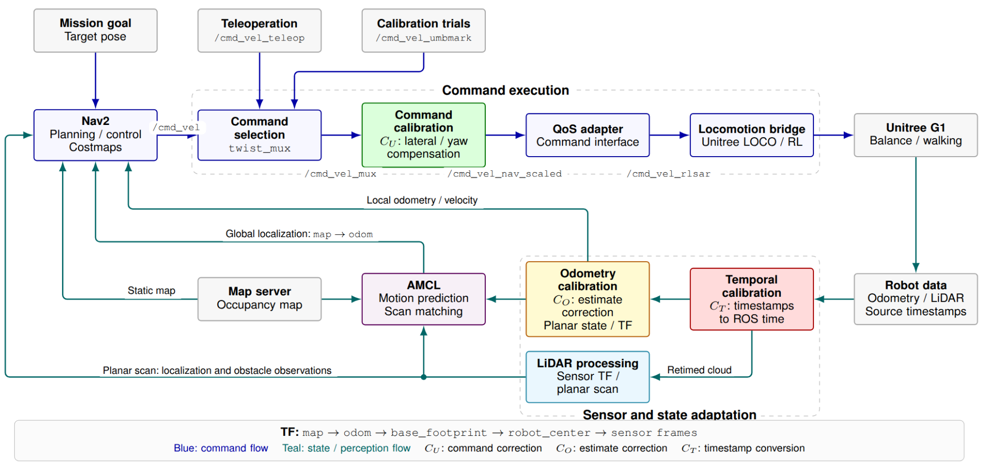

# Mapping and autonomous navigation

Start [hardware and sensors](hardware.md), then use the same [system entry point](../src/g1_social_bringup/launch/system.launch.py) for both tasks. Select the task with `navigation_mode`. The examples use profile A and run navigation on the PC. For onboard navigation, use `deployment:=robot_all host:=robot ros_distro:=foxy`. See [deployment](deployment.md) for role placement and RViz.

## Navigation architecture



For navigation on a saved map, follow the upper path from the mission goal through Nav2, command selection, optional compensation and the locomotion bridge. The lower path shows how odometry and planar scans feed localization and obstacle observations. The AMCL and map-server blocks describe saved-map navigation. For mapping, the launcher selects SLAM Toolbox.

**Profile A on PC.** In the supplied system launcher, remote image ingress is triggered by host placement even when social perception is disabled. This documentation bundle includes a [small launcher patch](profile-a-image-ingress.patch). On the PC checkout that uses that launcher, apply it once before either A recipe. Run from a sourced terminal. An already updated checkout can skip this step.

```bash
cd ~/g1_ws
git apply --check docs/profile-a-image-ingress.patch &&
git apply docs/profile-a-image-ingress.patch &&
colcon build --packages-select g1_social_bringup &&
source install/setup.bash
```
If the check fails, inspect the launcher before proceeding. The RGB/depth ingress predicates and compressed-image sender should all require a camera-enabled profile. B, C and D retain their existing image paths.

## Create and save a map

Use shared hardware with **camera=false**. In a prepared PC terminal, start asynchronous SLAM:
```bash
ros2 launch g1_social_bringup system.launch.py \
  profile:=A interaction:=none \
  deployment:=pc_perception host:=pc ros_distro:=humble \
  camera_transport:=raw enable_yolo:=false start_visual_odometry:=false \
  enable_visualization:=true enable_social_rviz:=false \
  enable_ros4hri_visualization:=false enable_raw_image_visualization:=false \
  navigation_mode:=slam
```
In a second PC terminal, the following check should print no matching nodes on a dedicated A session. If it prints one, identify the owning launch before continuing.
```bash
ros2 node list | grep -Ei 'realsense|yolo|image_ingress|rgb_network_transport|person_depth|person_tracking|visual_odometry|social_zone_generator'
```
Set the RViz fixed frame to `map`. Move the robot using the operator control already configured for your locomotion backend and observe the occupancy grid growing along the route. In another sourced PC terminal, check the map and save it under a fresh name:
```bash
ros2 topic info /map
mkdir -p "$HOME/g1_ws/maps"
ros2 run nav2_map_server map_saver_cli -f "$HOME/g1_ws/maps/g1_trial_01"
ls -l "$HOME/g1_ws/maps/g1_trial_01".*
```
Expect a map YAML and its referenced occupancy image. Stop the SLAM system launch with Ctrl+C before starting AMCL; the hardware can keep running.

## Navigate on a saved map

Use shared hardware with **camera=false**. Start with a saved map of the test area. In a prepared PC terminal:
```bash
map_file="$HOME/g1_ws/maps/g1_trial_01.yaml"
test -r "$map_file" &&
ros2 launch g1_social_bringup system.launch.py \
  profile:=A interaction:=none \
  deployment:=pc_perception host:=pc ros_distro:=humble \
  camera_transport:=raw enable_yolo:=false start_visual_odometry:=false \
  enable_visualization:=true enable_social_rviz:=false \
  enable_ros4hri_visualization:=false enable_raw_image_visualization:=false \
  navigation_mode:=nav2 map:="$map_file" controller:=dwb navigation_speed:=0.12
```
Use the selected odometry and scan from the shared hardware step. In RViz, set **2D Pose Estimate** at the robot’s actual position and heading. Check that the scan follows the walls. In another sourced terminal:
```bash
ros2 run tf2_ros tf2_echo map base_footprint
# After stopping the TF display with Ctrl+C:
ros2 action info /navigate_to_pose
```
Send a nearby reachable **Nav2 Goal**. Check that the action server accepts the goal and RViz reports arrival. Run the profile A node check below to confirm the visual and social pipelines are absent.
In a second PC terminal, the following check should print no matching nodes on a dedicated A session. If it prints one, identify the owning launch before continuing.
```bash
ros2 node list | grep -Ei 'realsense|yolo|image_ingress|rgb_network_transport|person_depth|person_tracking|visual_odometry|social_zone_generator'
```


## Calibration


For the calibration methodology covering timing, locomotion commands and odometry, see [g1_navigation_calibration](https://github.com/JeanMayoko18/g1_navigation_calibration).
