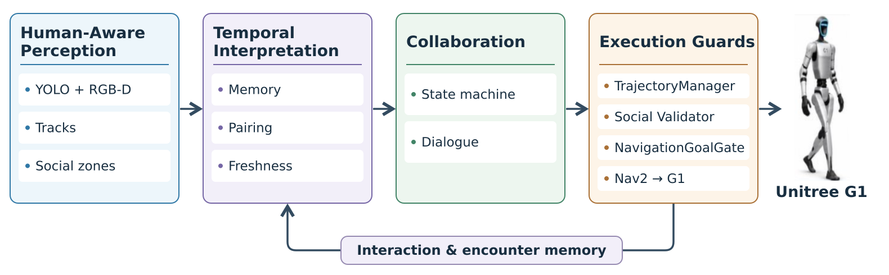
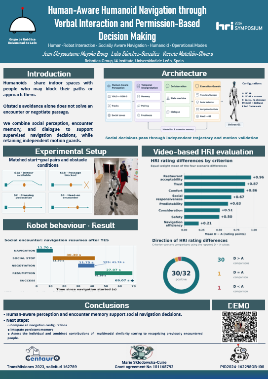

# Social navigation

Prepare the [shared hardware](hardware.md) with RGB-D enabled and use a saved map. The [system launcher](../src/g1_social_bringup/launch/system.launch.py) is the entry point for integrated social bringup. Its [launch directory](../src/g1_social_bringup/launch/) contains separate entry points for image ingress, perception, vision inference, social decisions, speech, navigation and visualization.

| Question during an encounter | Where to look |
| --- | --- |
| Is the same person tracked across frames, and is depth available? | [Person perception](../src/g1_social_perception/) |
| Who decides when to hold or resume the goal? | [Collaboration manager](../src/g1_robot_collaboration/) |
| How are speech and explanations produced? | [HRI](../src/g1_hri/) and [explainability](../src/g1_robot_explainability/) |
| Where are directional costmap constraints implemented? | [Social costmap](../src/g1_social_costmap/) |

## Social navigation architecture



Perception supplies tracks and social zones. Temporal interpretation uses memory, pairing and freshness to maintain encounter context. The collaboration state machine and dialogue inform the execution guards. The feedback arrow returns interaction and encounter memory to temporal interpretation.

<details>
<summary>View the original project poster with the architecture and encounter scenarios</summary>



</details>

## C · announcements

Start the shared hardware with **camera=true** and a saved map. Stop the preceding system launch on both hosts before changing profiles. Check RGB and aligned depth on the robot (Ctrl+C between checks).

```bash
ros2 topic hz /camera/camera/color/image_raw
ros2 topic hz /camera/camera/aligned_depth_to_color/image_raw
```
**Robot terminal 3 · speech and RGB transport**

```bash
ros2 launch g1_social_bringup system.launch.py \
  profile:=C interaction:=none deployment:=pc_perception \
  camera_transport:=compressed identity_backend:=yolo_track language:=en \
  host:=robot ros_distro:=foxy enable_yolo:=false \
  navigation_mode:=nav2 enable_visualization:=false
```
**PC terminal 1 · inference, collaboration and Nav2**

```bash
ros2 launch g1_social_bringup system.launch.py \
  profile:=C interaction:=none deployment:=pc_perception \
  camera_transport:=compressed identity_backend:=yolo_track language:=en \
  host:=pc ros_distro:=humble enable_yolo:=true \
  collaboration_manager_type:=simple_cd anticipatory_planning_enabled:=false \
  navigation_mode:=nav2 map:="$HOME/g1_ws/maps/g1_trial_01.yaml" \
  controller:=dwb navigation_speed:=0.12 start_visual_odometry:=false \
  enable_visualization:=true enable_social_rviz:=true
```
**PC terminal 2 · observe the encounter.** Check that the receiver and person tracker deliver data, set the initial pose in RViz and send a reachable goal.

```bash
ros2 topic hz /perception/transport/color
# With a person in view, inspect the available social, speech and HRI streams:
ros2 topic list -t | grep -E "social_navigation|explainability|/hri/"
```
Have a participant enter the path. Observe the stop and announcement, then have the participant clear the path. Check resumption or replanning and arrival at the original goal.

## D · dialogue

Start the shared hardware with **camera=true** and a saved map. Stop the preceding system launch on both hosts before changing profiles. Check RGB and aligned depth on the robot (Ctrl+C between checks).

```bash
ros2 topic hz /camera/camera/color/image_raw
ros2 topic hz /camera/camera/aligned_depth_to_color/image_raw
```
**Robot terminal 3 · speech and RGB transport**

```bash
ros2 launch g1_social_bringup system.launch.py \
  profile:=D interaction:=dialogue deployment:=pc_perception \
  camera_transport:=compressed identity_backend:=yolo_track language:=en \
  host:=robot ros_distro:=foxy enable_yolo:=false \
  navigation_mode:=nav2 enable_visualization:=false
```
**PC terminal 1 · inference, collaboration and Nav2**

```bash
ros2 launch g1_social_bringup system.launch.py \
  profile:=D interaction:=dialogue deployment:=pc_perception \
  camera_transport:=compressed identity_backend:=yolo_track language:=en \
  host:=pc ros_distro:=humble enable_yolo:=true \
  collaboration_manager_type:=simple_cd anticipatory_planning_enabled:=false \
  navigation_mode:=nav2 map:="$HOME/g1_ws/maps/g1_trial_01.yaml" \
  controller:=dwb navigation_speed:=0.12 start_visual_odometry:=false \
  enable_visualization:=true enable_social_rviz:=true
```
**PC terminal 2 · observe the encounter.** Check that the receiver and person tracker deliver data, set the initial pose in RViz and send a reachable goal.

```bash
ros2 topic hz /perception/transport/color
# With a person in view, inspect the available social, speech and HRI streams:
ros2 topic list -t | grep -E "social_navigation|explainability|/hri/"
```
Confirm microphone/ASR availability on the Humble dialogue host and audible speech on the robot. During a goal, have a participant enter the path, wait for the robot’s question and answer it. Observe permission and any agreed passing side, then the resumed goal. Record whether a directional mask was available when testing a side preference.

## Observe one encounter

For an announcement-only trial, inspect the sequence from detection to stop, announcement and clearance or replanning. For a negotiated trial, also record the person’s response, permission decision and any directional constraint before resumption. Record the selected profile and interaction setting with the trial.

With navigation idle, observe the intrusion announcement separately. Assigning a goal changes the navigation context even if the same person remains visible. During a directional trial, distinguish a confirmed human preference from an operational costmap mask. The intended fallback when the mask is unavailable is autonomous Nav2 route selection after the other resume conditions are satisfied. Verify that transition in the recorded run.

Use the [social trial recording script](../scripts/record_social_trial.sh) and the [stationary-person protocol](../protocol_stationary_person.md) to reproduce an encounter.
